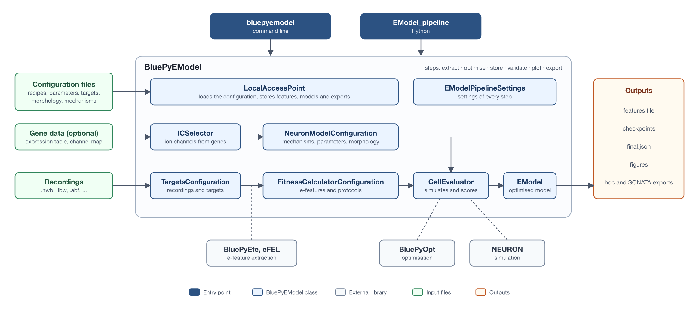
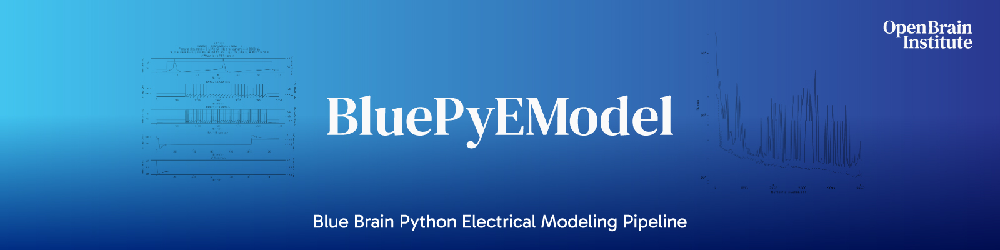

|banner|

BluePyEModel: Blue Brain Python Electrical Modeling Pipeline
============================================================

+----------------+------------+
| Latest Release | |pypi|     |
+----------------+------------+
| Documentation  | |docs|     |
+----------------+------------+
| License        | |license|  |
+----------------+------------+
| Build Status 	 | |tests|    |
+----------------+------------+
| Coverage       | |coverage| |
+----------------+------------+
| Citation       | |zenodo|   |
+----------------+------------+

Introduction
------------

The Blue Brain Python Electrical Modeling Pipeline (BluePyEModel) is a Python package facilitating the configuration and execution of electrical neuron model (e-model) building tasks. It covers tasks such as extraction of electrical features from electrophysiology data, e-model parameters optimisation and model validation. As such, it builds on top of `eFEL <https://github.com/openbraininstitute/eFEL>`_, `BluePyEfe <https://github.com/openbraininstitute/BluePyEfe>`_ and `BluePyOpt <https://github.com/openbraininstitute/BluePyOpt>`_.

For a general overview and example of electrical model building, please refer to the paper: `A universal workflow for creation, validation and generalization of detailed neuronal models <https://doi.org/10.1016/j.patter.2023.100855>`_.

Note that this package only covers e-model building based on patch-clamp data and that it relies solely on the `NEURON <https://www.neuron.yale.edu/neuron/>`_ simulator.

How to cite
-----------
If you use this repository in your work, please use the ``Cite this repository`` button at the top of the repository page to get various citation formats, including APA and BibTeX.

For detailed citation information, please refer to the `CITATION.cff <./CITATION.cff>`_ file.

Additionally, to cite software used for different steps of the pipeline, please use these :

- Optimisation and Validation:
   - ``BluePyOpt``: `Van Geit et al., 2016 <https://doi.org/10.3389/fninf.2016.00017>`_
   - ``NEURON``:  The NEURON Book: Carnevale and Hines 2006 : https://doi.org/10.1017/CBO9780511541612

- Feature Extraction:
   - ``eFEL``: `Zenodo DOI: 10.5281/zenodo.19604220 <https://doi.org/10.5281/zenodo.19604220>`_
   - ``BluePyEfe``: `Zenodo DOI: 10.5281/zenodo.19591682 <https://doi.org/10.5281/zenodo.19591682>`_

- Ion Channel Selector: `Me-Features-to-Mo-ID Mapping <https://github.com/openbraininstitute/me-features-to-mo-ID-mapping>`_: paper: `Roussel et al., 2023 <https://doi.org/10.1371/journal.pcbi.1010058>`_

Requirements
------------

Python 3.11 or later, on Linux or macOS (on Windows, use WSL). ``pip`` installs the other dependencies, including the `NEURON <https://www.neuron.yale.edu/neuron/>`__ simulator; see ``pyproject.toml`` for the full list.

Installation
------------

BluePyEModel can be pip installed with the following command:

.. code-block:: console

    pip install bluepyemodel

The optional dependencies ``test`` and ``docs`` install what is needed to run the tests and to build the documentation, for example ``pip install bluepyemodel[test]``.

The Nexus access point and the Luigi workflow were removed in BluePyEModel 2.0. They remain available in BluePyEModel 1.x.

Getting started
---------------

.. image:: https://raw.githubusercontent.com/openbraininstitute/BluePyEModel/main/doc/images/pipeline.png
   :alt: E-Model building pipeline

The pipeline has six steps, run in this order:

* ``extract``: extracts e-features from the recordings and averages them over the sweeps at each target amplitude.
* ``optimise``: builds a NEURON cell model and optimises its parameters against the extracted e-features.
* ``store``: reads the results of the optimisation and stores the best model of each seed in a local json file, ``final.json``.
* ``validate``: runs the stored models on validation protocols, which were not used for optimisation, and decides whether each model is good enough.
* ``plot``: plots the traces, e-feature scores, parameters and optimisation progress of the stored models.
* ``export``: exports the stored models as hoc templates for NEURON, or in SONATA format for circuit simulations.

Each step is a command of the ``bluepyemodel`` command line, and ``run`` runs them all. With the `simplecell example <https://github.com/openbraininstitute/BluePyEModel/tree/main/examples/simplecell>`_:

.. code-block:: console

    cd examples/simplecell
    sh download_ephys_data.sh
    bluepyemodel run --emodel simplecell --recipes-path config/recipes.json \
        --etype cADpyr --species rat --brain-region SSCX --seed 1 --force-extraction

The steps are also available from Python, with the ``EModel_pipeline`` class. The `documentation <https://bluepyemodel.readthedocs.io/>`_ describes the configuration files and every command, and the `L5PC example <https://github.com/openbraininstitute/BluePyEModel/tree/main/examples/L5PC/>`_ builds a detailed pyramidal cell model on a laptop or a Slurm cluster.

Main classes
------------

Acknowledgment
--------------

This work was supported by funding to the Blue Brain Project, a research center of the École polytechnique fédérale de Lausanne (EPFL), from the Swiss government’s ETH Board of the Swiss Federal Institutes of Technology. This work has been partially funded by the European Union Seventh Framework Program (FP7/2007­2013) under grant agreement no. 604102 (HBP), and by the European Union’s Horizon 2020 Framework Programme for Research and Innovation under the Specific Grant Agreements No. 720270 (Human Brain Project SGA1) and No. 785907 (Human Brain Project SGA2) and by the EBRAINS research infrastructure, funded from the European Union’s Horizon 2020 Framework Programme for Research and Innovation under the Specific Grant Agreement No. 945539 (Human Brain Project SGA3).

Copyright
---------

Copyright (c) 2023-2024 Blue Brain Project/EPFL

Copyright (c) 2025 Open Brain Institute

This work is licensed under `Apache 2.0 <https://www.apache.org/licenses/LICENSE-2.0.html>`_

.. |license| image:: https://img.shields.io/badge/License-Apache%202.0-blue.svg
                :target: https://github.com/openbraininstitute/BluePyEModel/blob/main/LICENSE.txt

.. |tests| image:: https://github.com/openbraininstitute/BluePyEModel/actions/workflows/test.yml/badge.svg?branch=main&event=push
   :target: https://github.com/openbraininstitute/BluePyEModel/actions/workflows/test.yml
   :alt: CI

.. |pypi| image:: https://img.shields.io/pypi/v/bluepyemodel.svg
               :target: https://pypi.org/project/bluepyemodel/
               :alt: latest release

.. |docs| image:: https://readthedocs.org/projects/bluepyemodel/badge/?version=latest
               :target: https://bluepyemodel.readthedocs.io/
               :alt: latest documentation

.. |coverage| image:: https://codecov.io/gh/openbraininstitute/bluepyemodel/branch/main/graph/badge.svg
                   :target: https://codecov.io/gh/openbraininstitute/bluepyemodel
                   :alt: coverage

.. |zenodo| image:: https://zenodo.org/badge/DOI/10.5281/zenodo.19593077.svg
                 :target: https://doi.org/10.5281/zenodo.19593077

..
    The following image is also defined in the index.rst file, as the relative path is
    different, depending from where it is sourced.
    The following location is used for the github README
    The index.rst location is used for the docs README; index.rst also defined an end-marker,
    to skip content after the marker 'substitutions'.

.. substitutions
