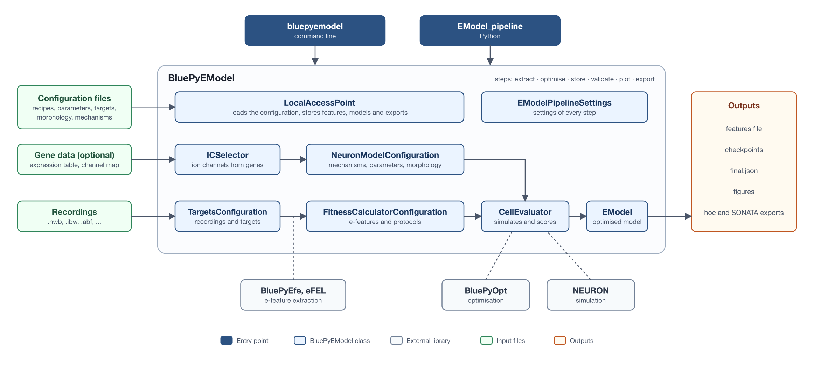

Concepts
========

An electrical model (e-model) is a set of ion channel mechanisms, their distributions over a
neuron's morphology and the values of their parameters. BluePyEModel builds e-models whose
responses reproduce the electrical features (e-features) of patch-clamp recordings, following the
workflow of `Reva et al., 2023 <https://doi.org/10.1016/j.patter.2023.100855>`_.

The pipeline
------------

.. list-table::
   :header-rows: 1
   :widths: 15 45 40

   * - Step
     - What it does
     - Output
   * - extract
     - Computes e-features of the recordings with `BluePyEfe <https://github.com/openbraininstitute/BluePyEfe>`_
       and `eFEL <https://github.com/openbraininstitute/eFEL>`_, averaged over the sweeps at each
       target amplitude, and defines the protocols that reproduce the stimuli.
     - The features file of the recipe.
   * - optimise
     - Searches the parameter values whose responses best match the e-features, with
       `BluePyOpt <https://github.com/openbraininstitute/BluePyOpt>`_ (CMA-ES or a genetic
       algorithm). One optimisation per seed.
     - A checkpoint per seed, in ``checkpoints/``.
   * - store
     - Reads a checkpoint and keeps its best model.
     - An entry in ``final.json``.
   * - validate
     - Runs the stored models on the validation protocols, which were not used for optimisation,
       and decides whether each model passes.
     - The ``validated`` field of the entries of ``final.json``.
   * - plot
     - Simulates the stored models and plots traces, scores, parameters and optimisation progress.
     - ``figures/``.
   * - export
     - Writes stored models as hoc templates, or in SONATA format for circuit simulations.
     - ``export_emodels_hoc/`` or ``export_emodels_sonata/``.

Each step reads the outputs of the previous ones, so they run in this order. Extraction can be
skipped when the features file is written by hand or comes from an earlier project.

Main classes
------------

The command line and :class:`~bluepyemodel.emodel_pipeline.emodel_pipeline.EModel_pipeline` run
the steps. :class:`~bluepyemodel.access_point.local.LocalAccessPoint` reads the configuration
files and writes the results. The extraction turns the recordings and targets
(:class:`~bluepyemodel.efeatures_extraction.targets_configuration.TargetsConfiguration`) into
e-features and protocols
(:class:`~bluepyemodel.evaluation.fitness_calculator_configuration.FitnessCalculatorConfiguration`).
The evaluator simulates the model described by
:class:`~bluepyemodel.model.neuron_model_configuration.NeuronModelConfiguration` on these protocols
and scores it; the optimisation keeps the best models as
:class:`~bluepyemodel.emodel_pipeline.emodel.EModel`.

E-features and protocols
------------------------

An e-feature is a quantity measured on a voltage trace with eFEL, such as the number of spikes,
the mean firing frequency or the resting membrane potential. A target is an e-feature measured
during a protocol (for example ``IDrest``, a step current) at a given stimulus amplitude. The
extraction computes the mean and standard deviation of each target over the recordings; during
optimisation, the score of an e-feature is its distance to the mean, in standard deviations.

The amplitudes of the targets are either:

* **absolute**, in nA, with the pipeline setting ``extract_absolute_amplitudes: true``. The model
  receives the same currents as the recorded cell.
* **relative to the rheobase** of each recorded cell (the default), in percent. This compares
  cells of different excitability. The model then runs threshold-based protocols: before the main
  protocols, it measures its own resting potential and input resistance, searches the holding
  current that keeps it at the recorded holding potential, and searches its own rheobase. The
  stimuli are then scaled to the model's rheobase. This needs the pipeline settings
  ``name_rmp_protocol`` and ``name_Rin_protocol``, which name the protocols and amplitudes used
  for the resting potential and the input resistance (for example ``["IV", 0]`` and
  ``["IV", -20]``).

E-model names and metadata
--------------------------

An e-model is identified by its name (``--emodel`` on the command line) and its metadata: e-type,
t-type, m-type, species, brain region and iteration tag. They are optional, but they are part of
the names of the checkpoints, figures and exported models, and of the entries of ``final.json``,
for example::

    checkpoints/simplecell/None/emodel=simplecell__etype=cADpyr__species=rat__brain_region=SSCX__seed=1.pkl

Give the same name and metadata to every step of a run, or later steps do not find the results of
earlier ones.

The iteration tag names a run of the pipeline. With a tag, the configuration files are read from
``./run/<tag>/``, which lets you keep several versions of a model side by side, for example one
per git commit (see the `L5PC example <https://github.com/openbraininstitute/BluePyEModel/tree/main/examples/L5PC>`_).

Parallelisation
---------------

Each optimisation evaluates many models per generation. They are simulated in parallel with
multiprocessing on one machine (the default), or with ipyparallel on several machines. Several
seeds are independent optimisations and can run as separate jobs.
